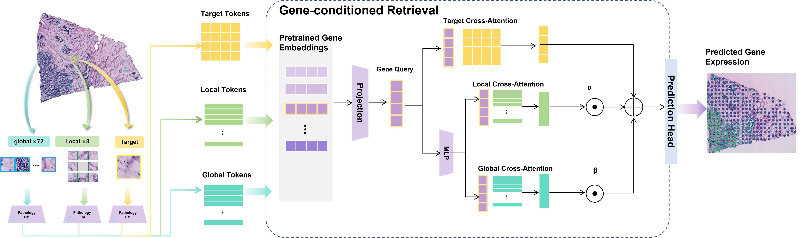
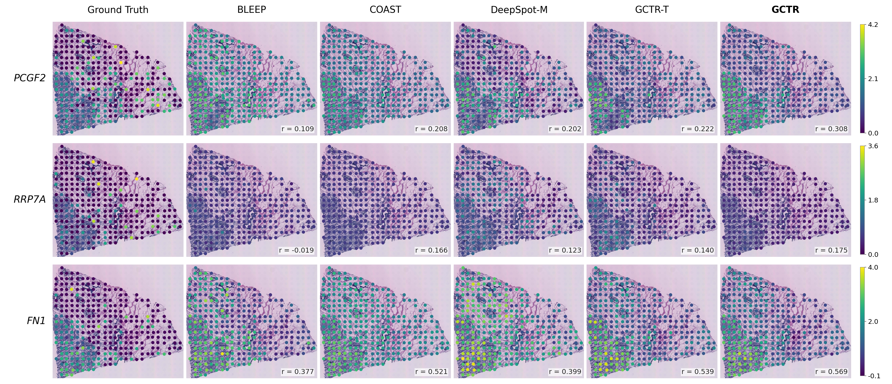
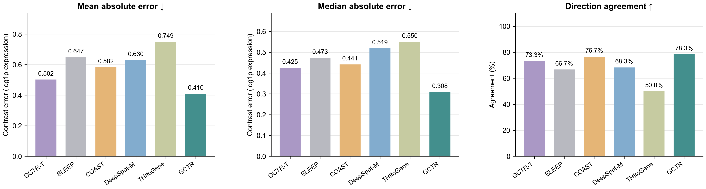

# GCTR

**Gene-Conditioned Context Retrieval for Spatial Gene Expression Prediction**

GCTR predicts spatial gene expression from H&E morphology. A fixed gene query retrieves spatial tokens from the target crop and pooled morphology from eight local tiles and up to 72 same-section global candidates. Local and global retrieval share attention parameters while normalizing their candidates separately. Two learned scalar coefficients combine the retrieved context with the target representation before a shared expression head.

<p align="center"></p>

## Quick start

Python 3.10 or later is required. The core implementation has been checked with PyTorch 2.2.2. Install a PyTorch build appropriate for your CPU or CUDA environment, then install the remaining requirements.

```bash
pip install -r requirements.txt
python main.py demo --device cpu
```

The demo runs a forward and backward pass on synthetic inputs. It checks tensor shapes and execution; it does not load a dataset, use pretrained weights, or report benchmark accuracy. The default model has **2,566,787 parameters** and predicts `[B,256]` expression values.

## Entry point and options

`main.py` is the only command-line entry point. `options.py` contains all defaults and argument definitions.

| Option | Default | Meaning |
|---|---:|---|
| `--seed` | 0 | One training seed per invocation |
| `--dim` | 256 | Projected feature and gene-query dimension |
| `--num-genes` | 256 | Frozen gene-panel size |
| `--tokens` | 256 | Spatial target tokens |
| `--layers` / `--heads` | 2 / 8 | Target retrieval layers and attention heads |
| `--dropout` | 0.1 | Attention and feed-forward dropout |
| `--batch-size` | 8 | Spots per training/inference batch |
| `--lr` | 0.0001 | AdamW learning rate |
| `--weight-decay` | 0.000001 | AdamW weight decay |
| `--epochs` | 30 | Maximum training epochs |
| `--patience` | 0 | Validation PCC early stopping; 0 disables it |

The paper model uses Midnight features, the pretrained two-layer target decoder, a `256→384→256` context-query MLP, and a shared context attention layer. Fusion is `target + sigmoid(a) × local + tanh(b) × global`, initialized with `sigmoid(a)=0.1` and `b=0`. Image encoding and gene queries remain frozen. The training objective is masked MSE.

## Data

See [data/README.md](data/README.md) for the feature, geometry and supervision interface. Only a manifest template is included; no dataset, private path, gene panel or pretrained checkpoint is bundled.

| Dataset | Partition used in the experiments |
|---|---|
| HER2ST | Train C/D/G; validation H; test B |
| GSE273378 / LUAD | Frozen 10/2/2-patient split and dataset-specific V2 panel |
| HEST ccRCC | Official outer fold 0; internal validation INT16/INT18/INT9 |

HER2ST data are available from the [HER2ST project](https://github.com/almaan/her2st), LUAD from [GSE273378](https://www.ncbi.nlm.nih.gov/geo/query/acc.cgi?acc=GSE273378), and ccRCC from [HEST](https://huggingface.co/datasets/MahmoodLab/hest). Follow each source's access and licensing requirements. Sample-to-patient grouping is supplied through the manifest; it is never inferred from sample names. The HEST grouping depends on its published patient attribution.

Freeze each dataset's panel and patient split before training. Gene selection and normalization parameters must not be fitted on validation/test expression. Preserve the original feature, gene and spot ordering, masks, and MPP-aware 154.05 µm crops when reproducing an existing run.

## Train

```bash
python main.py train --manifest data/manifest.csv --genes data/genes.csv --queries data/gene_queries.npy --pretrained weights/DeepSpotM/model.safetensors --device cuda --output outputs/gctr
```

Only Train/Validation sections are loaded. Validation **mean gene-wise PCC** selects `best_pcc.pt`, with the earliest epoch retained on ties. `best_mse.pt` and `last.pt` are also saved. There is no automatic Test evaluation, parameter search or multi-seed launcher.

To enable validation-only early stopping, add `--patience 10`. For a fixed-budget reproduction, keep the original epoch budget and disable early stopping. Reproducing a checkpoint requires its actual training budget as well as the same data and initialization. Matching model code alone does not guarantee a particular table value.

```bash
python main.py train --manifest data/manifest.csv --genes data/genes.csv --queries data/gene_queries.npy --pretrained weights/DeepSpotM/model.safetensors --resume outputs/gctr/last.pt --output outputs/gctr --device cuda
```

Resume uses the original output directory and restores model, optimizer and random states. Keep the original manifest, features, batch size and options unchanged.

## Evaluate or predict

Freeze the validation-selected checkpoint before opening Test labels:

```bash
python main.py evaluate --manifest data/manifest.csv --genes data/genes.csv --checkpoint outputs/gctr/best_pcc.pt --split test --device cuda --output outputs/test
```

Evaluation preserves the manifest/spot order and computes masked gene-wise PCC, spot-wise PCC, MSE and MAE. Undefined correlations remain undefined rather than being filled with zero. Outputs include predictions, genes, spot IDs, masks, pooled metrics, per-section metrics and section-level mean ± SD. The section SD is descriptive variation across sections, not independent-patient uncertainty.

Prediction does not require expression targets or supervision files:

```bash
python main.py predict --manifest data/manifest.csv --genes data/genes.csv --checkpoint outputs/gctr/best_pcc.pt --split test --device cuda --output outputs/predictions
```

## Examples from the manuscript

Spatial expression predictions:



Pathology-region expression contrasts:



These are manuscript illustrations, not outputs generated by the synthetic demo. Selected visual cases and region summaries have different scopes from the full-panel benchmark.

## Project files

```text
main.py          Command-line entry point
options.py       Input paths, dimensions and training options
model.py         Target/local/global retrieval and fusion
data.py          Cache reader and same-section global sampling
engine.py        Single-run training, prediction and evaluation
metrics.py       Masked loss and correlation metrics
features.py      Optional frozen Midnight feature extraction
data/            Dataset interface and manifest template
assets/          Manuscript figures
licenses/        Third-party terms
```

## Pretrained components and attribution

The target decoder is adapted from [DeepSpot-M](https://github.com/ratschlab/DeepSpotM), whose [official checkpoint](https://huggingface.co/ratschlab/DeepSpotM) supplies the frozen Midnight image mapping and scGPT-derived gene queries used in the experiments. The optional image extra pins the upstream code revision used during development. Use the corresponding official checkpoint and preprocessing rather than substituting a pooled image embedding for spatial target tokens.

The adapted decoder carries **PolyForm Noncommercial 1.0.0** terms; upstream model weights carry separate **CC-BY-NC-SA-4.0** terms. See [NOTICE](NOTICE), [decoder terms](licenses/DeepSpotM.txt) and [weight terms](licenses/DeepSpotM-weights.md). Pretrained weights are not redistributed here.
